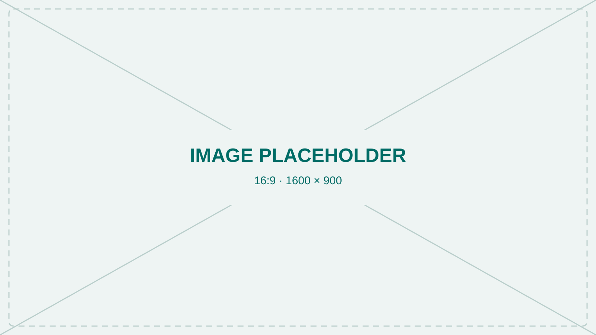

## OPENING SECTION {.section-slide
background-image="../assets/branding/section_bg.png"
background-size="cover"
background-position="center"}

<p class="section-subtitle">One-sentence framing of the lecture</p>

---

## Opening Question

::: {.v-center}

A concise statement of the problem or question for this session.

::: {.fragment}
**Core question:** What do we want students to be able to explain?
:::

:::

---

## Two Columns

:::: {.columns}

::: {.column width="50%"}

**Key point**

- Point one
- Point two
- Point three [@boxScienceStatistics1976]

:::

::: {.column width="50%"}

{width=90% fig-alt="Description of figure" .img-card}

<p class="image-credit">Image/source credit</p>

:::

::::

---

## Key Concept

::: {.callout-card}

**Definition**

State the central idea here.

:::

::: {.fragment}
Then reveal the implication or qualification.
:::

---

## Hosted Image

Upload images with `scripts/sync-media.ps1`, then refer to them by their path
inside `images/`:

```markdown
{.img-card width=70% fig-align="center"}
```

---

## References Cited {.smaller}

::: {#refs}
:::
